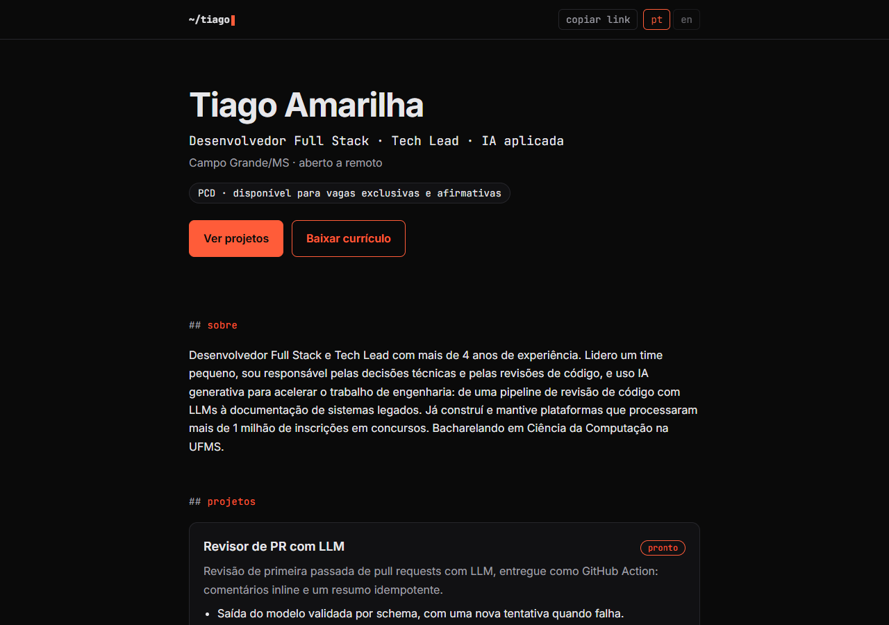
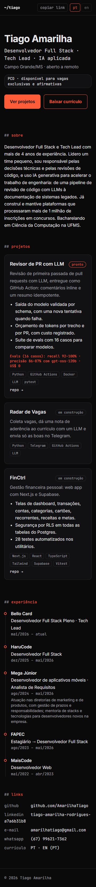
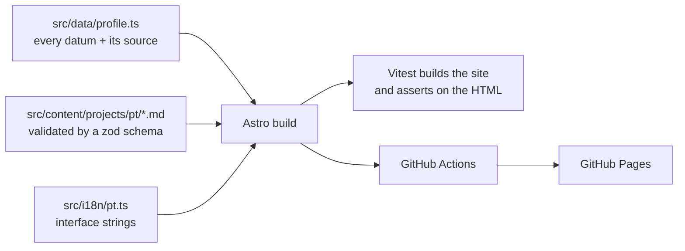

# amarilhatiago.github.io

Personal portfolio of Tiago Amarilha: a single-page, dark, terminal-style site built with Astro and Tailwind, in Portuguese and English, with a projects section driven by Markdown files and a downloadable résumé. Live at https://amarilhatiago.github.io

## Screenshots

## Why it exists

A portfolio has one job in a hiring process: let a recruiter see, in seconds, who the person is, what they built, and how to reach them or get the résumé. This one is built around that: a projects section that grows by adding a file, a download button for the CV, and a layout that works at 360 px and with the keyboard only.

It also follows one rule: **no invented facts.** Every name, date, role and link on the page comes from a tracked source (résumé, LinkedIn export, GitHub, or a text the owner wrote), and the code records which one.

## How it works

Components read facts only from `profile.ts` and the dictionary, and projects only from the content collection. Adding a project is creating one `.md` file; an invalid file fails the build with a clear message.

## Results

Measured with Lighthouse 13.6.0 (headless Edge) against the production build served locally, on 2026-11-04. Raw reports are in [`docs/cards/014-a11y-lighthouse/`](docs/cards/014-a11y-lighthouse).

| Mode | Performance | Accessibility | Best Practices | SEO |
|---|---|---|---|---|
| Mobile | 100 | 100 | 100 | 100 |
| Desktop | 100 | 100 | 100 | 100 |
| Mobile (English page) | 100 | 100 | 100 | 100 |
| Desktop (English page) | 100 | 100 | 100 | 100 |

- 72 automated tests, all passing; they build the site and check the generated HTML, CSS, sitemap and assets.
- No horizontal scroll at 360 px, and every interactive element is reachable and visible with the keyboard (checked with a headless browser, see the card verification files).

## Usage

1. `npm ci`
2. `npm run dev` and open http://localhost:4321
3. To add a project, create `src/content/projects/pt/<slug>.md` (copy an existing one for the fields) and it shows up on the page.

Other commands: `npm test`, `npm run build`, `npm run lighthouse` (after a build).

## Engineering decisions and trade-offs

- **Sources are part of the type.** Each datum in `profile.ts` is a `Sourced<T>` (`value` + `source`), so a field without an origin does not compile, and a test walks the whole structure to enforce it. Trade-off: a little verbosity for facts that can always be traced.
- **Content collection with a schema.** Projects are Markdown files validated by zod. Trade-off: front matter is stricter than free-form Markdown, in exchange for build-time errors instead of a broken card.
- **Tests build the real site.** The suite runs `astro build` into a private folder and asserts on the output (titles, links, order, metadata, files). It also creates a throwaway project file to prove that adding one needs no code change. Trade-off: slower than unit tests, so test files run sequentially.
- **One page, two languages.** Components receive a `lang` and read the dictionary, the profile data and the projects of that language (one content folder per language), so `/` and `/en/` cannot drift apart in structure. Trade-off: every user-visible string has to live in a dictionary or in the data.
- **Design tokens in one place.** Colors live in a single CSS theme block and a check keeps raw hex values out of the components.
- **Self-hosted fonts** (`@fontsource`) instead of a font CDN: no third-party request, better performance.
- **Lighthouse by script, not in CI.** Browser versions drift and scores wobble; the committed reports are the evidence.
- **OG image and favicons are generated once** by a script (headless Edge) and committed, so the build has no browser dependency.
- **No analytics, no backend, no CMS.** Deliberate scope cut for a static page.
- **Small cards, trunk-based.** Each change was a card with a spec, a plan and a verification file (acceptance criteria mapped to evidence) under [`docs/cards/`](docs/cards), merged to `main` the same day with green CI.

## Next steps

- English résumé PDF (the English page points to the Portuguese file for now).
- Custom domain through a `CNAME` file.
- Run Lighthouse in CI with a pinned browser.

## 🇧🇷 Resumo em português

Portfólio pessoal do Tiago Amarilha: página única em português e inglês, tema escuro e estética de terminal, feita com Astro e Tailwind e publicada no GitHub Pages. A seção de projetos é alimentada por arquivos Markdown (adicionar um projeto é criar um arquivo) e há um botão para baixar o currículo.

- **Regra principal:** nenhum dado inventado. Cada dado do site vem de uma fonte registrada no código (currículo, LinkedIn, GitHub ou texto do próprio Tiago).
- **Resultados medidos (04/11/2026):** Lighthouse 100 em Desempenho, Acessibilidade, Boas Práticas e SEO, no celular e no desktop; 72 testes automatizados passando; sem scroll horizontal em 360 px e navegação completa por teclado.
- **Como usar:** `npm ci`, `npm run dev` e, para um projeto novo, criar `src/content/projects/pt/<slug>.md`.
- **Processo:** cards pequenos, cada um com spec, plano e verificação (critério de aceite → evidência) em `docs/cards/`, integrados na `main` no mesmo dia.
- **Próximos passos:** PDF do currículo em inglês, domínio próprio e Lighthouse no CI.
